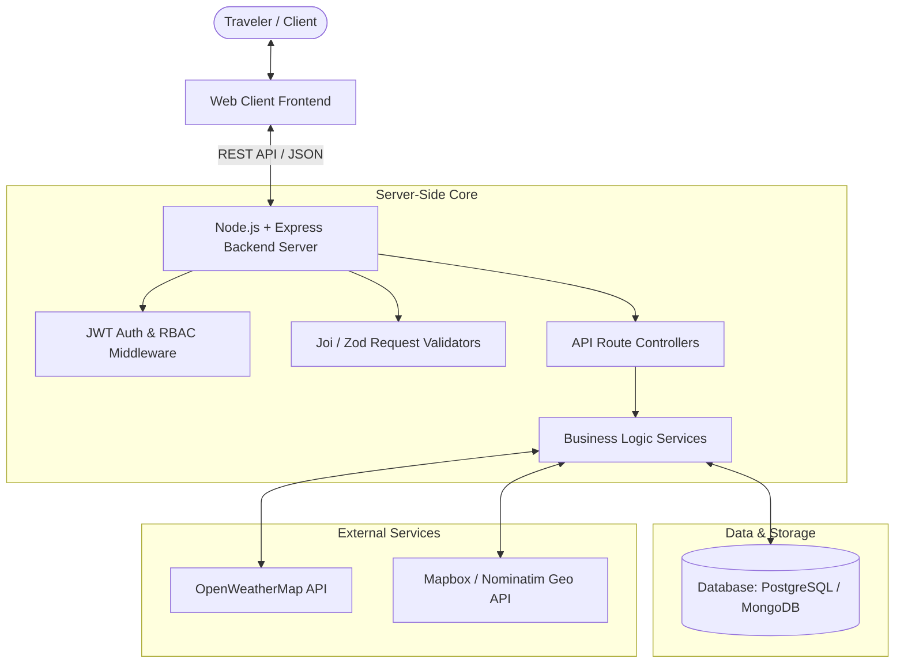
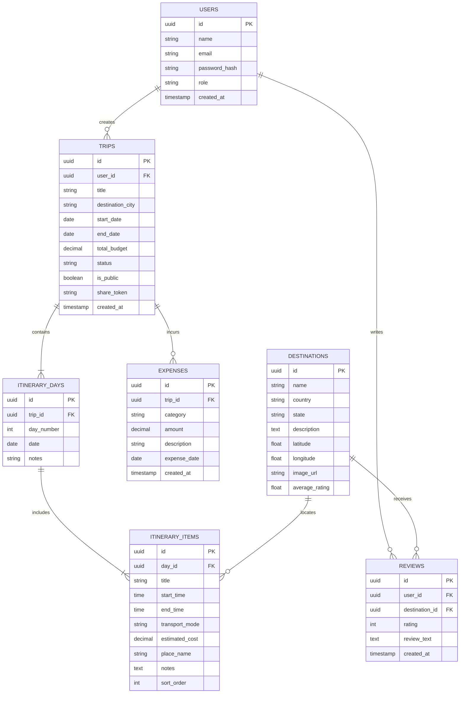

# 🌍 Travel Planner — College Project Implementation Plan Sheet

**Course:** 7th Semester — Server-Side Web Development  
**Project Title:** Intelligent Travel Planner & Itinerary Management System  
**Document Type:** Comprehensive Implementation & Architecture Blueprint  

---

## 1. Project Overview & Problem Statement

### 1.1 Abstract
Planning a multi-day trip involves juggling destination research, daily scheduling, transportation logistics, fluctuating weather conditions, and expense tracking across disconnected apps and spreadsheets. 

**Travel Planner** is a centralized server-side web application designed to help travelers search destinations, generate and customize day-wise itineraries, track trip budgets in real-time, inspect live weather forecasts, share itineraries with friends/public, and read/post community reviews.

### 1.2 Core Objectives
1. **Dynamic Itinerary Builder:** Create, update, and reorder day-by-day travel schedules with specific activities and transportation modes.
2. **Real-Time Weather Integration:** Pull live weather forecasts for travel dates and destinations to ensure trip preparedness.
3. **Smart Budgeting & Expense Tracking:** Set a target trip budget, break it down by categories (stay, food, travel, activities), and track real expenses.
4. **Community Reviews & Ratings:** Enable travelers to post ratings, reviews, and travel tips for destinations.
5. **Trip Sharing & Collaboration:** Generate shareable public links or export itineraries as structured PDFs.
6. **Robust Server-Side Architecture:** Implement secure authentication, role-based access control, RESTful APIs, input validation, and database normalization.

---

## 2. Recommended Technology Stack

Given that this is a **7th Semester Server-Side** project, the architecture emphasizes clean backend patterns, API design, security, and database modeling.

| Layer | Recommended Choice | Alternatives | Justification |
| :--- | :--- | :--- | :--- |
| **Backend Server** | **Node.js + Express.js** | Python (Django/FastAPI) / Java (Spring Boot) | Lightweight, asynchronous I/O, rich npm ecosystem, quick REST API development. |
| **Database** | **PostgreSQL (with Prisma/Sequelize)** *or* **MongoDB (with Mongoose)** | MySQL | Relational DB is ideal for college evaluation (clean schema, foreign keys, normalization). MongoDB is great if itineraries have flexible nested daily schedules. |
| **Authentication** | **JWT (JSON Web Tokens) + bcrypt** | Session cookies | Stateless, secure, industry standard for REST APIs. |
| **Frontend UI** | **React / Vite + Modern CSS** | EJS/Handlebars (SSR) or Next.js | Dynamic, reactive state management for dragging/reordering itinerary items and responsive charts for budget tracking. |
| **Third-Party APIs**| • **OpenWeatherMap API** (Weather)<br>• **Mapbox / Leaflet OpenStreetMap** (Route & Maps)<br>• **Unsplash / Pexels API** (Destination photos) | Google Places API | Free-tier friendly with reliable developer quotas. |
| **Documentation & Testing** | **Postman / Swagger (OpenAPI) & Jest** | Supertest | Crucial for project viva and submission reports. |

---

## 3. System Architecture & Flow



---

## 4. Database Schema Design

### 4.1 Entity Relationship (Relational Model)



---

## 5. RESTful API Endpoints Specification

### 5.1 Authentication Module (`/api/auth`)
| Method | Endpoint | Description | Auth Required |
| :--- | :--- | :--- | :--- |
| `POST` | `/api/auth/register` | Register new user account | No |
| `POST` | `/api/auth/login` | Authenticate user & return JWT | No |
| `GET` | `/api/auth/me` | Fetch currently logged-in user profile | Yes (Bearer) |

### 5.2 Destinations & Weather Module (`/api/destinations`)
| Method | Endpoint | Description | Auth Required |
| :--- | :--- | :--- | :--- |
| `GET` | `/api/destinations` | Search destinations with keyword & category filters | No |
| `GET` | `/api/destinations/:id` | Get destination details, photos & average rating | No |
| `GET` | `/api/destinations/:id/weather`| Fetch real-time weather & 5-day forecast for destination | No |

### 5.3 Trips & Dynamic Itinerary Module (`/api/trips`)
| Method | Endpoint | Description | Auth Required |
| :--- | :--- | :--- | :--- |
| `GET` | `/api/trips` | Get all trips created by the logged-in user | Yes |
| `POST` | `/api/trips` | Create a new trip (title, dates, budget, destination) | Yes |
| `GET` | `/api/trips/:id` | Get trip with full day-by-day itinerary breakdown | Yes |
| `PUT` | `/api/trips/:id` | Update trip basic details | Yes |
| `DELETE`| `/api/trips/:id` | Delete a trip | Yes |
| `POST` | `/api/trips/:id/days/:dayId/items` | Add activity/route item to a specific day | Yes |
| `PUT` | `/api/trips/:id/items/:itemId` | Edit an activity/transportation detail | Yes |
| `DELETE`| `/api/trips/:id/items/:itemId` | Delete an activity from day itinerary | Yes |
| `PUT` | `/api/trips/:id/days/:dayId/reorder` | Reorder activities sort order (drag & drop) | Yes |

### 5.4 Budgeting & Expense Tracker (`/api/trips/:id/expenses`)
| Method | Endpoint | Description | Auth Required |
| :--- | :--- | :--- | :--- |
| `GET` | `/api/trips/:id/expenses` | Get all expenses and budget utilization summary | Yes |
| `POST` | `/api/trips/:id/expenses` | Log a new expense (category, amount, receipt) | Yes |
| `DELETE`| `/api/trips/:id/expenses/:expId`| Remove an expense entry | Yes |

### 5.5 Social Sharing & Reviews (`/api/reviews`, `/api/shared`)
| Method | Endpoint | Description | Auth Required |
| :--- | :--- | :--- | :--- |
| `POST` | `/api/trips/:id/share` | Generate public shareable URL token | Yes |
| `GET` | `/api/shared/trip/:shareToken` | Public read-only view of a trip itinerary | No |
| `POST` | `/api/destinations/:id/reviews` | Submit a review & rating (1-5 stars) | Yes |
| `GET` | `/api/destinations/:id/reviews` | List all user reviews for destination | No |

---

## 6. Implementation Phases (6-Week Roadmap)

```
Week 1: Foundations & Architecture  ──►  Week 2: Auth & Database CRUD
                       │                                    │
                       ▼                                    ▼
Week 3: External APIs (Weather/Maps) ──► Week 4: Budget & Sharing Modules
                       │                                    │
                       ▼                                    ▼
Week 5: UI & Interactive Frontend   ──►  Week 6: Testing, Docs & Viva Prep
```

### **Week 1: Requirements, System Design & Setup**
- [ ] Finalize Software Requirement Specification (SRS).
- [ ] Initialize repository structure (`/server` and `/client`).
- [ ] Design Database ER Diagram and write migration scripts / ORM models.
- [ ] Setup Git workflow, environment configs (`.env.example`), and ESLint/Prettier.

### **Week 2: Backend Core & Authentication**
- [ ] Setup Express server with standard middleware (CORS, Helmet, Morgan, JSON parser).
- [ ] Implement User Registration, Password hashing (`bcrypt`), and JWT generation.
- [ ] Build Authentication & Authorization middleware.
- [ ] Implement CRUD endpoints for Trips and Destinations.

### **Week 3: Itinerary Engine & External Weather APIs**
- [ ] Implement Day-by-day Itinerary generation logic based on start and end dates.
- [ ] Create endpoints to add, update, delete, and reorder activities and transport options.
- [ ] Integrate OpenWeatherMap API:
  - Cache weather calls (in-memory/Redis or 30-min DB cache) to respect API rate limits.
  - Return current conditions, temperature, humidity, wind, and forecast warnings.

### **Week 4: Budget Tracker, Social Sharing & Reviews**
- [ ] Build expense logger with category breakdown (Lodging, Food, Travel, Activities, Misc).
- [ ] Add budget analytics helper (total spent, remaining budget, percentage alerts).
- [ ] Build Trip Sharing module (UUID token generator, public read-only endpoint).
- [ ] Implement Destination review system with rating calculations.

### **Week 5: Frontend Interface & Seamless Integration**
- [ ] Build clean, responsive UI:
  - **Dashboard:** Active trips, upcoming trips, budget overview cards.
  - **Itinerary Canvas:** Interactive timeline of daily activities with transport badges.
  - **Weather Widget:** Live forecast badge showing weather per itinerary day.
  - **Budget Tracker:** Visual progress bar and pie-chart breakdown.
  - **Destination Explorer:** Search bar with destination cards and review drawer.
- [ ] Connect frontend to backend APIs using Axios/Fetch with JWT interceptors.

### **Week 6: Testing, Polish & College Viva Deliverables**
- [ ] Write API integration tests using Jest/Supertest for critical routes.
- [ ] Error handling & validation hardening (no unhandled promise rejections).
- [ ] Generate Postman Collection / Swagger API documentation.
- [ ] Prepare College Project Deliverables (Report, PPT slides, Demo video/script).

---

## 7. College Project Deliverables Checklist

To score top marks in your 7th Semester evaluation, ensure the following deliverables are prepared:

1. **Project Synopsis & SRS Document:**
   - Functional & Non-Functional Requirements.
   - Use Case Diagrams, Data Flow Diagrams (DFD Level 0, 1, 2).
2. **Database & Architecture Documentation:**
   - Entity Relationship (ER) Diagram with Cardinalities.
   - Database schema dictionary (table names, datatypes, constraints).
3. **API Documentation:**
   - Exported Postman Collection with sample requests/responses.
   - Swagger OpenAPI interactive UI.
4. **Source Code & Git Repository:**
   - Clean folder structure separating controllers, models, routes, and services.
   - Comprehensive `README.md` with installation steps (`npm install`, `.env`, `npm run dev`).
5. **Presentation & Live Demo:**
   - Slide deck (12-15 slides covering Problem, Architecture, Tech Stack, Features, Screenshots, Challenges, Future Scope).
   - Live demo showing: Register -> Create Trip -> Check Weather -> Add Itinerary -> Track Budget -> Share Trip -> Review Place.

---

## 8. Anticipated Viva / External Examiner Questions & Answers

| Potential Examiner Question | Strong Answer Strategy |
| :--- | :--- |
| **"Why did you choose your specific database (e.g. PostgreSQL vs MongoDB)?"** | *"We evaluated both: PostgreSQL provides strict ACID compliance and relational integrity for financial budget tracking and user associations, while MongoDB offers schema flexibility for diverse itinerary activity structures. We selected [X] because..."* |
| **"How do you handle API rate limits for the Weather Service?"** | *"We implemented server-side caching (30-60 min TTL) based on city/coordinates so multiple itinerary views for the same destination don't exhaust the third-party API quota."* |
| **"How is security managed on the server side?"** | *"Passwords are hashed with salt rounds using bcrypt. All protected endpoints require a signed JWT token checked via an authentication middleware. User input is validated before reaching controllers to prevent injection."* |
| **"How does the public trip sharing work without compromising private data?"** | *"A randomized unique share token is generated. The public endpoint filters out sensitive owner details (like user email or private financial notes) and returns a read-only projection."* |
